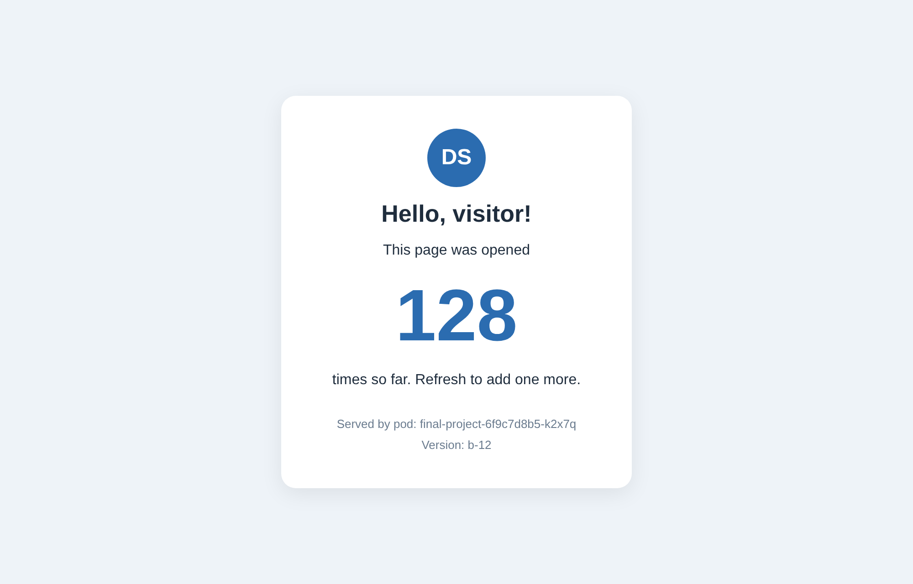

# DevOps Final Project

A small web app that counts the visits to its page, with a full CI/CD flow on Kubernetes.



- **App:** Python (Flask) and a MongoDB database. Every visit is saved in MongoDB and the page shows the total.
- **CI:** Jenkins builds, tests and checks every branch. From main it also publishes the image and the Helm chart to Docker Hub.
- **CD:** Argo CD deploys the newest version to the `dev` environment by itself.
- **Monitoring:** Prometheus collects the metrics of the app and Grafana shows them.

## How a change gets to the dev environment

1. Work on a feature branch and push it to GitHub.
2. Jenkins runs the pipeline on the branch: Docker build, unit tests, Helm lint and Helm template.
3. Open a pull request. After it is merged to main, Jenkins runs again and also publishes the image `david147852/final-project-app:b-<build>` and the chart `final-project-chart` version `1.0.<build>` to Docker Hub.
4. Argo CD finds the new chart version and deploys it to the `dev` namespace.
5. If a build fails, Jenkins sends a Discord message and an email.

## Cluster layout

| Namespace | What runs there |
|---|---|
| `default` | Jenkins and its build agents, MongoDB |
| `observation` | Prometheus and Grafana |
| `argocd` | Argo CD |
| `dev` | The app |

## What is in this repository

| Path | What it is |
|---|---|
| `app.py` | The web app: the page, `/health`, `/ready` and `/metrics` |
| `db.py` | The database layer. Only this file talks to MongoDB |
| `templates/index.html` | The web page |
| `test_app.py` | Unit tests. They use a fake database, so they run anywhere |
| `Dockerfile` | The image of the app |
| `chart/` | The Helm chart of the app |
| `Jenkinsfile` | The CI pipeline |
| `infra/mongodb/` | MongoDB |
| `infra/monitoring/` | Prometheus and Grafana |
| `infra/jenkins/` | Jenkins |
| `infra/argocd/` | Argo CD and the dev environment |

## Install order

On a Kubernetes cluster (the one in Docker Desktop is enough):

1. [MongoDB](infra/mongodb/README.md)
2. [Prometheus and Grafana](infra/monitoring/README.md)
3. [Jenkins](infra/jenkins/README.md)
4. [Argo CD and the dev environment](infra/argocd/README.md)

## Run the unit tests

```
pip install -r requirements-dev.txt
pytest -v
```

## Quick demo without Jenkins and Argo CD

Runs the app in the `default` namespace, next to MongoDB (install MongoDB first):

```
docker build -t david147852/final-project-app:dev .
helm install final-project chart --set serviceMonitor.enabled=false
kubectl port-forward svc/final-project 5000:5000
```

Open http://localhost:5000 and refresh the page a few times.
